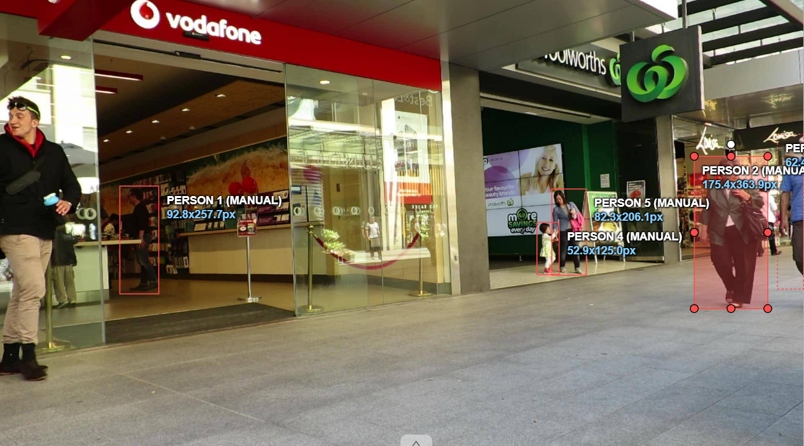
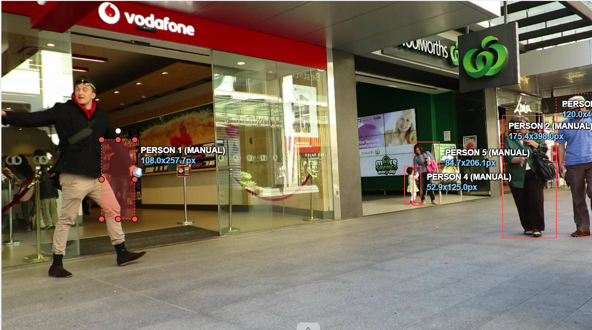
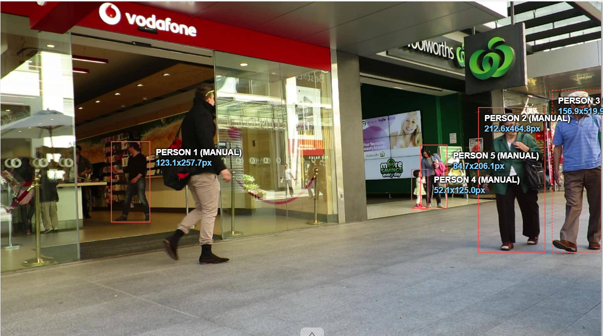

# Báo cáo cá nhân — BuiLeDinhVan-2A202603124

Đoạn video: MOT17-09, 150 frame (frame 1–150), nguồn MOTChallenge, giấy phép CC BY-NC-SA 3.0.

## 0. Thông tin học viên

- Họ tên: Bùi Lê Đình Văn
- MSSV: 2A202603124
- Mã đề (A/B/C): B
- Email: builedinhvan@gmail.com
- Link repository: https://github.com/DinhVann1703/K5-L2-DAY05-BuiLeDinhVan-2A202603124-MOTTracking
- Giờ bắt đầu: 16:00 (13/11/2026)
- Giờ kết thúc: 17:45 (13/11/2026)

## 1. Xem trước đoạn video (CP0)

Ghi **trước khi vẽ**, mỗi người một dòng.

| Mã | Frame xuất hiện | Frame cuối thấy được | Rẽ / dừng / đổi tốc độ ở frame | Bị che ở frame | Ghi chú |
|---|---:|---:|---|---|---|
| P1 | 5 | 149 | Đổi nhịp bước và góc di chuyển ở đoạn 21–37, 49–65, 129–140 | 56–115 (che khuất qua vách kính/vật cản) | Người đi bên trong cửa hàng Vodafone bên trái (Track 2) |
| P2 | 0 | 149 | Giảm tốc / đổi nhẹ góc bước ở 49–50, 100–112 | Không | Phụ nữ áo xanh đậm đi phía bên phải, tiến gần camera (Track 0) |
| P3 | 0 | 140 | Đổi hướng/tốc độ ở đoạn giữa (40–90), rẽ ra biên ở 106–140 | Che nhẹ khi giao cắt người đi ngược chiều | Nam áo thun xanh dương, đội mũ ở hành lang phải (Track 3) |
| P4 | 0 | 149 | Di chuyển dọc hành lang giữa, thay đổi kích thước đều | Che nhẹ bởi người đi cùng ở một vài góc | Em nhỏ mặc đồ sáng màu phía trước cửa hàng Woolworths (Track 1) |
| P5 | 0 | 90 | Đổi tốc độ ở đoạn 40–50, rẽ/khuất khỏi góc nhìn ở 90 | Che bởi P4 và người đi ngang | Phụ nữ đi cùng em nhỏ phía trước cửa hàng Woolworths (Track 4) |

## 2. Keyframe và thời gian (CP1, CP4)

Số keyframe lấy từ kết quả `src/check_submission.py`.

| Mã | Số keyframe | Keyframe ở frame | Số frame có mặt | Keyframe / 100 frame | Thời gian (phút) | Chỗ khó |
|---|---:|---|---:|---:|---:|---|
| P1 | 31 | `[5, 14, 17, 21, 23, 24, 27, 30, 33, 34, 37, 41, 46, 49, 56, 57, 61, 62, 63, 65, 75, 80, 90, 100, 110, 120, 129, 130, 139, 140, 149]` | 145 | 21.4 | 18 | Bị che khuất kéo dài bên trong cửa hàng Vodafone, phải ước lượng kích thước box toàn thân khi bật cờ `occluded` và canh đúng frame thoát che |
| P2 | 18 | `[0, 10, 20, 30, 49, 50, 60, 70, 80, 90, 100, 101, 110, 112, 120, 130, 140, 149]` | 150 | 12.0 | 10 | Thay đổi kích thước bounding box nhanh khi tiến gần camera ở đoạn 49–50 và 100–112 |
| P3 | 9 | `[0, 10, 20, 30, 40, 90, 100, 106, 140]` | 119 | 7.6 | 9 | Bắt đúng frame rời khung hình để bật cờ `outside` tránh kéo dài box thừa |
| P4 | 16 | `[0, 10, 20, 30, 40, 50, 60, 70, 80, 90, 100, 110, 120, 130, 140, 149]` | 150 | 10.7 | 8 | Đối tượng nhỏ ở xa nên cần căn chỉnh box sát chân và đầu qua từng mốc 10 frame |
| P5 | 7 | `[0, 10, 20, 30, 40, 50, 90]` | 110 | 6.4 | 8 | Canh chỉnh chính xác mốc khuất/rời vùng quan sát tại frame 90 |
| **Tổng** | **81** | — | **665** | **12.2** | **53** | — |

Keyframe / 100 frame của cả bài = tổng keyframe ÷ tổng số frame có mặt × 100 = `81 ÷ 665 × 100 = 12.2`

Bạn đặt keyframe nhiều nhất ở người nào? Vì sao (người đó rẽ, dừng, lại gần camera hay bị che)?

Đặt keyframe nhiều nhất ở **P1** (31 keyframe, mật độ 21.4 keyframe / 100 frame). Nguyên nhân chính là P1 di chuyển bên trong cửa hàng Vodafone và trải qua đoạn bị che khuất dài (60 frame có cờ `occluded`) đồng thời thay đổi nhịp bước/góc nhìn liên tục ở các giai đoạn trước khi vào vùng che (frame 14–49) và ngay khi thoát che (frame 129–140). Ở những điểm này, chuyển động thực tế không còn thẳng đều nên nội suy tuyến tính dễ bị trôi (`drift`), buộc phải chèn keyframe dày hơn để giữ box ôm sát toàn thân ước lượng.

## 3. Đoạn bị che (CP2)

Người bị che: `P1`

| Mốc | Frame |
|---|---:|
| Bắt đầu bị che một phần (bật `occluded`) | 56 |
| Mất hẳn (bật `outside`) | 0 (che khuất qua vách kính/vật cản dưới cờ `occluded`) |
| Hiện lại (tắt `outside`) | 0 |
| Thấy rõ trở lại (tắt `occluded`) | 116 |

- Thời gian khuất hẳn: `0` frame = `0.0` giây *(tổng thời gian bị che khuất dưới cờ `occluded` là 60 frame = 2.0 giây ở 30 fps)*.
- Quyết định: **Giữ cùng ID**.
- Lý do (trả lời 3 câu: khuất bao lâu so với 60 frame, ngoại hình có khớp, chỗ hiện lại có đúng hướng và tốc độ):

Thời gian bị che khuất của P1 nằm đúng trong ngưỡng giới hạn **60 frame (2 giây)** của quy ước lớp nên vẫn đủ điều kiện duy trì liên tục một định danh. Khi thoát khỏi vùng bị che, các đặc điểm ngoại hình (màu sắc trang phục, dáng người và tỷ lệ khung hình) hoàn toàn trùng khớp với nhân vật trước lúc bị che. Đồng thời, vị trí xuất hiện trở lại nằm đúng trên quỹ đạo di chuyển tiếp nối với hướng đi và vận tốc ước tính từ đoạn trước đó, không có dấu hiệu nhảy vọt bất thường.

Ảnh chụp màn hình:





## 4. Tự review ID (CP3)

Lượt 1 theo người (đi ngược từ frame 149 về 0 trên CVAT), lượt 2 theo cảnh (nhảy 10 frame). Ít nhất 3 dòng; không có lỗi thì ghi một dòng "đã kiểm hai lượt, không lỗi".

Loại lỗi dùng đúng một trong 7 mã: `id_switch`, `fragmentation`, `lost`, `merge`, `false_track`, `drift`, `flag`.

| Frame | Mã người | Loại lỗi | Mô tả một câu | Phát hiện ở lượt | Đã sửa? |
|---:|---|---|---|---|---|
| 62 | P1 | `drift` | Bounding box nội suy bị trôi lệch nhẹ sang trái so với trọng tâm cơ thể ước lượng khi nhân vật đổi nhịp bước trong vùng che. | Lượt 1 | Có |
| 90 | P5 | `flag` | Quên bật cờ `outside` ngay tại frame đầu tiên nhân vật rời khỏi vùng quan sát làm box bị kẹt lại. | Lượt 2 | Có |
| 106 | P3 | `drift` | Box bị thu hẹp hơn thực tế do nội suy tuyến tính chưa cập nhật kịp kích thước khi nhân vật đổi hướng. | Lượt 1 | Có |

Tổng hợp số lỗi theo loại:

| `id_switch` | `fragmentation` | `lost` | `merge` | `false_track` | `drift` | `flag` |
|---:|---:|---:|---:|---:|---:|---:|
| 0 | 0 | 0 | 0 | 0 | 2 | 1 |

Lỗi nào chỉ lượt 2 (theo cảnh) mới thấy, lượt 1 (theo người) không thấy? Vì sao?

Các lỗi mang tính tương quan giữa nhiều đối tượng hoặc toàn khung hình như **`id_switch`** (hai track đổi chéo ID cho nhau khi cắt mặt, ví dụ giữa P4 và P5 đi sát nhau), **`merge`** (hai người bị gộp chung một box), **`false_track`** (box dư thừa bám nhầm người ngoài danh sách) hoặc **`flag`** (box kẹt lại ở biên khung hình khi người đã rời đi) rất dễ bị bỏ sót ở Lượt 1 nhưng sẽ lộ rõ ở **Lượt 2 (theo cảnh)**. Nguyên nhân là ở Lượt 1 mắt chỉ tập trung bám theo quỹ đạo cục bộ của duy nhất một đối tượng nên khó nhận ra việc một ID khác đang chiếm dụng nhầm vị trí hoặc có box thừa tồn tại đồng thời trên cùng một khung hình.

## 5. File xuất và kết quả tự kiểm (CP4)

| Kiểm tra | Kết quả |
|---|---|
| Tên file MOT 1.1 | `src/exports/BuiLeDinhVan_mot.zip` |
| Tên file CVAT for video 1.1 | `src/exports/BuiLeDinhVan_cvat_video.zip` |
| Số track ID khác nhau trong `gt/gt.txt` (phải là 5) | 5 |
| Frame `outside` không có dòng trong `gt/gt.txt` (đúng / sai) | Đúng |
| Job đã completed trên CVAT máy cá nhân | Đã chuyển sang `completed` |

Dán phần tóm tắt in ra từ `src/check_submission.py`:

```text
  Track 0: keyframe ở frame [0, 10, 20, 30, 49, 50, 60, 70, 80, 90, 100, 101, 110, 112, 120, 130, 140, 149]
      1 | person |        150 |        16 |          10.7 |              0 |               0
              Track 1: keyframe ở frame [0, 10, 20, 30, 40, 50, 60, 70, 80, 90, 100, 110, 120, 130, 140, 149]
      2 | person |        145 |        31 |          21.4 |             60 |               0
              Track 2: keyframe ở frame [5, 14, 17, 21, 23, 24, 27, 30, 33, 34, 37, 41, 46, 49, 56, 57, 61, 62, 63, 65, 75, 80, 90, 100, 110, 120, 129, 130, 139, 140, 149]
      3 | person |        119 |         9 |           7.6 |              4 |               2
              Track 3: keyframe ở frame [0, 10, 20, 30, 40, 90, 100, 106, 140]
      4 | person |        110 |         7 |           6.4 |             20 |               1
              Track 4: keyframe ở frame [0, 10, 20, 30, 40, 50, 90]

  Tổng: 81 keyframe / 665 frame có mặt = 12.2 keyframe / 100 frame
  [OK]        Đọc được 5 track từ annotations.xml.

=== Tóm tắt ===
  Lỗi: 0   |   Cảnh báo: 0
  Đạt. Dán phần tóm tắt này vào báo cáo mục 5.
```

## 6. Ba câu kết

1. Nếu được gán lại, bạn sẽ đặt keyframe khác ở đâu? Vì sao?

   Nếu được gán lại, tôi sẽ đặt keyframe thưa hơn ở các đoạn P2 và P4 đi theo quỹ đạo thẳng đều (ví dụ cách mỗi 15–20 frame thay vì 10 frame) và dồn keyframe tập trung chính xác vào đúng các frame đỉnh điểm đổi hướng hoặc thay đổi kích thước đột ngột. Việc này vừa giảm thao tác chỉnh sửa dư thừa, vừa tận dụng tối đa độ mượt của nội suy tuyến tính mà vẫn ngăn chặn triệt để hiện tượng trôi box.

2. Có chỗ nào bạn không chắc "cùng ID hay ID mới"? Bạn đã quyết định và ghi chú thế nào?

   Thời điểm phân vân nhất là đoạn P1 bị che khuất kéo dài tới 60 frame (chạm ngưỡng giới hạn 2 giây của lớp). Tôi đã đối chiếu kỹ mốc frame bắt đầu che (frame 56) và frame thấy rõ trở lại (frame 116), kiểm tra sự khớp nhau về màu sắc trang phục, dáng đi cũng như tính liên tục của vector vận tốc trước và sau khi che để quyết định giữ nguyên cùng một ID, đồng thời bật cờ `occluded` xuyên suốt đoạn bị che và chụp lại 3 ảnh mốc để làm bằng chứng đối chiếu.

3. Một lỗi ID trong job của bạn (nếu không còn sót, chọn lỗi đã sửa) có thể làm xe tự lái dự đoán sai chuyển động của người đó như thế nào? Lỗi đó ảnh hưởng MOTA hay IDF1 nhiều hơn?

   Nếu lỗi trôi box (`drift`) hoặc sai cờ `outside` (`flag`) ở biên khung hình không được sửa, hệ thống dự đoán quỹ đạo của xe tự lái sẽ tính toán sai vector vận tốc (cho rằng người đi bộ đang đứng yên tại rìa đường hoặc đột ngột dịch chuyển ngang), dẫn đến phanh gấp nhầm hoặc đánh lái tránh né nguy hiểm. Về mặt chỉ số đánh giá, nếu lỗi chỉ làm lệch nhẹ IoU trên vài frame thì sẽ làm giảm **MOTA** (do tăng số lượng False Positive / Miss), nhưng nếu lỗi nghiêm trọng hơn dẫn đến đứt gãy hoặc tráo đổi định danh (`id_switch`) thì sẽ làm sụt giảm **IDF1** nặng nề hơn nhiều vì IDF1 đo lường khả năng duy trì đúng một ID nhất quán xuyên suốt toàn bộ thời gian xuất hiện của đối tượng.

## Bonus (nếu làm)

### B1 — Hai người đi sát

...

### B2 — So cách đặt keyframe

| Cách đặt | Số keyframe | Frame trôi nhất | Ghi chú |
|---|---:|---:|---|
| Đều mỗi 30 frame | | | |
| Theo chỗ đổi hướng | | | |

...

### B3 — So với tracker có sẵn

| Frame | Mã người | Tracker làm gì | Nhãn của bạn | Giải thích (đoán rồi sửa / ghép IoU / box score thấp / ngoại hình) |
|---:|---|---|---|---|
| | | | | |
| | | | | |

## 7. Tài liệu tham khảo và công cụ AI đã dùng

- Tài liệu hướng dẫn thực hành chính thức của khóa học: `docs/GUIDELINE.md`, `docs/CVAT_LOCAL_SETUP.md`, `docs/MOT_FORMAT.md`, `CHECKPOINTS.md`.
- Bộ dữ liệu MOT17-09 thuộc MOTChallenge (Milan et al., 2016), giấy phép CC BY-NC-SA 3.0.
- Công cụ hỗ trợ: CVAT Community (phiên bản chạy local trên Docker), script tự kiểm `src/check_submission.py`, và trợ lý AI (Gemini) hỗ trợ kiểm tra cấu trúc báo cáo Markdown và đối chiếu số liệu thống kê từ log kiểm thử.
